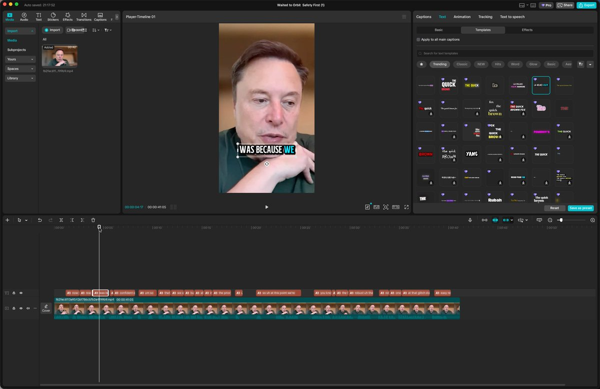
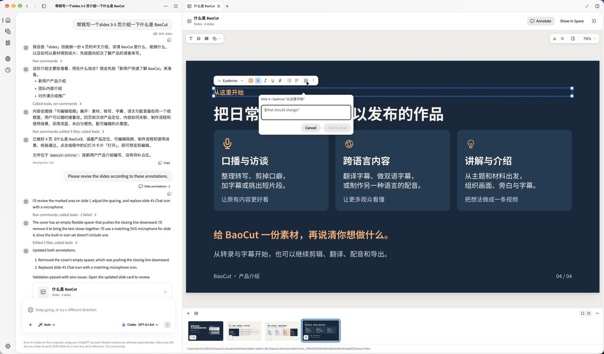
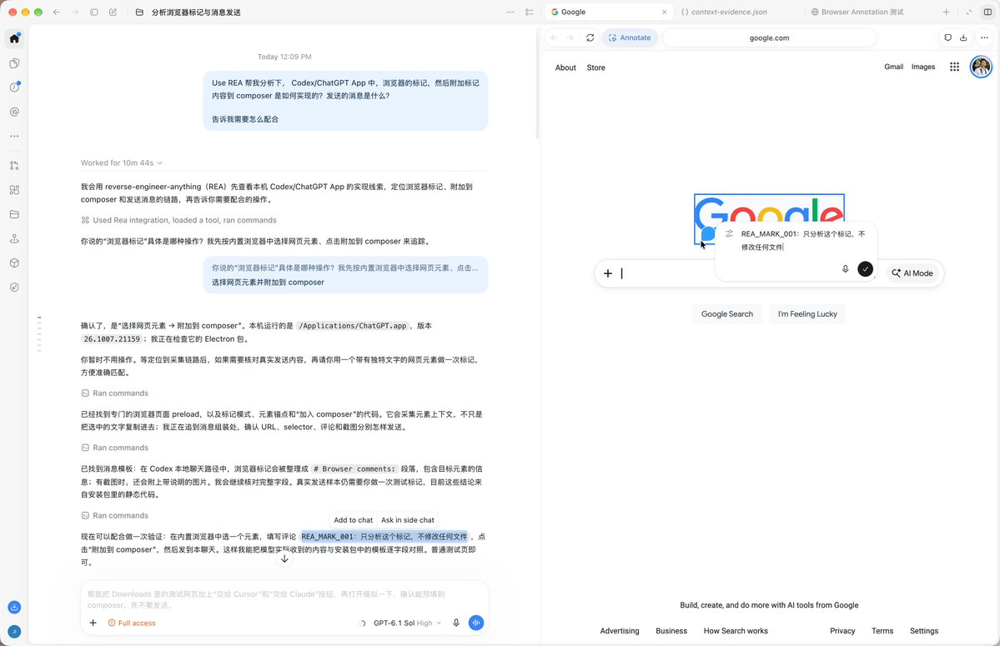

# Awesome REA

收集 [REA（Reverse Engineer Anything）](https://github.com/morluto/rea) 的真实应用实例：调查什么、怎么做、发现了什么，以及原始证据在哪里。

A multilingual collection of REA investigations, with original sources, workflows, and the scope of each reported result. Contributions in any language are welcome.

**[浏览网站 / Explore the collection](https://jyjyxt.github.io/awesome-rea/)** · [完整案例集](CASES.md) · [推荐案例](https://github.com/jyjyxt/awesome-rea/issues/new?template=case.yml) · [REA 官网](https://rea.tools)

目前收录 **13 条案例与相关思路**，来源覆盖 **中文、英文、日文**。网站提供中英文界面，可按应用、作者、工具、分类、原帖语言和证据类型搜索筛选。

## 网站预览


## 示例图片

### CapCut 动态字幕模板

作者结合 REA、Codex 与 Computer Use，通过界面操作追踪下载地址和本地文件，报告收集了 2,291 个模板。截图为 CapCut 的字幕模板界面。[原帖：@dotey](https://x.com/dotey/status/2109470081776283941)



### Claude Slides 编辑器

作者使用 REA 分析前端脚本，再重写编辑器相关实现；公开了实现提交，便于继续检查。[原帖：@dotey](https://x.com/dotey/status/2109151666020794711) · [实现提交](https://github.com/JimLiu/baocut/commit/b8585e0c8d7a82bdee9f0ed019cf6edb075e41c1)



### Codex / ChatGPT 浏览器注解

作者用 REA 追踪 Electron 应用中网页注解到消息的路径，并测试外部页面调用注解接口。其测试能打开注解框并预填内容，直接附加到 composer 尚未成功。[原帖：@dotey](https://x.com/dotey/status/2109417222724600172)



图片归原作者及相关权利人所有，出处见 [图片来源](docs/images/README.md)。以上为原帖截图与编辑摘要，案例成果未经本站独立复现。

## 更多案例

| 对象 | 调查与产出 | 来源 |
| --- | --- | --- |
| 智能马桶 / BLE | 分析小程序蓝牙协议，作者演示原生菜单栏遥控 | [X：@thinkszyg](https://x.com/thinkszyg/status/2109309251533570509) |
| DX-Ball 1.07 | 单个声像函数的重建、3,205 次差分测试与字节匹配 | [官方调查](https://rea.tools/showcase/dx-ball/) · [代码](https://github.com/N0zoM1z0/dx-ball) |
| Notion Desktop | 追踪 preload、IPC 到剪贴板写入的路径 | [官方调查](https://rea.tools/showcase/notion/) |
| Electron 静态分析（日文） | 用自建四文件应用检查 API、IPC 的识别能力 | [作者实测](https://note.com/kaigai_tech/n/n47bb7d83bc60) |
| Lemmings（英文） | 作者报告正在用 REA 重建 1991 年游戏并逐像素调整 | [X：@AZERDSQ0329](https://x.com/AZERDSQ0329/status/2109599439471923391) |

全部案例的双语摘要、证据范围和原始链接见 [CASES.md](CASES.md)。用户提供的 [@jinglian](https://x.com/jinglian/status/2109567957890429431) 和 [@LinearUncle](https://x.com/LinearUncle/status/2109467895013281896) 帖文也已收录；原作者未确认使用 REA 的内容标为「相关思路」。

## 本地运行

需要 Node.js 22 或更新版本，无需安装第三方依赖。

```sh
npm run build
npm run preview
```

打开 <http://127.0.0.1:4173/awesome-rea/>。构建产物位于 `dist/`；所有案例都有独立页面，在禁用 JavaScript 时仍可阅读。

## 更新与部署

- 案例数据：[`data/cases.json`](data/cases.json)，每条包含原始语言、双语摘要、步骤、结果、证据范围与来源。
- 新增案例：参考 [CONTRIBUTING.md](CONTRIBUTING.md)，支持任何原帖语言。
- 校验与构建：`npm run build`，同时更新 `CASES.md`。
- GitHub Pages：仓库 **Settings → Pages → Source** 选择 **GitHub Actions**；推送至 `main` 后由 [部署工作流](.github/workflows/pages.yml) 自动发布。
- 来源与检索记录：[docs/RESEARCH.md](docs/RESEARCH.md)。

这是独立社区收集，与 REA 官方无隶属关系。
